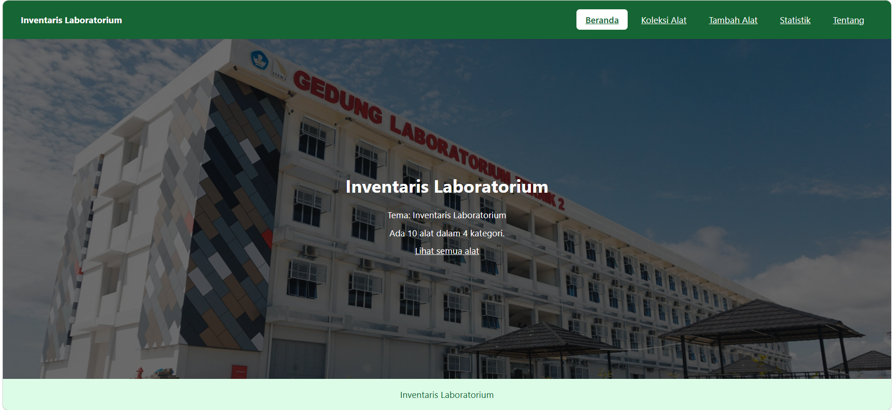
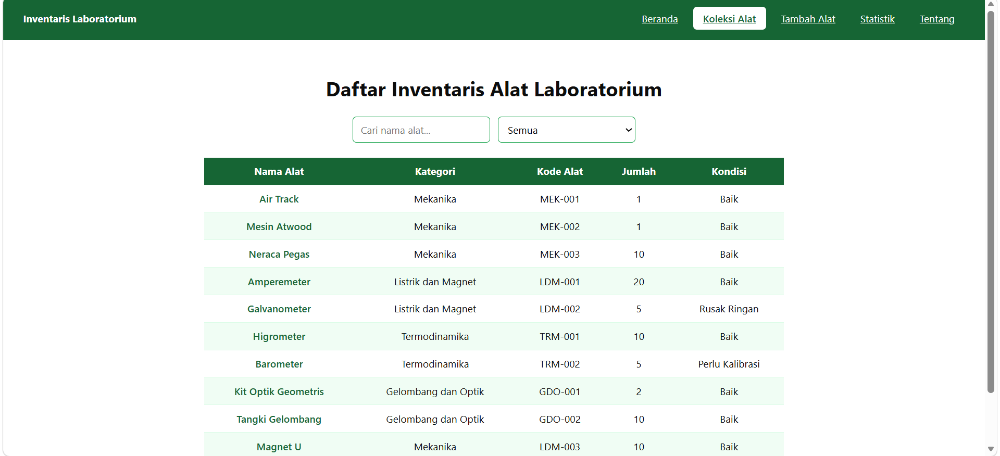
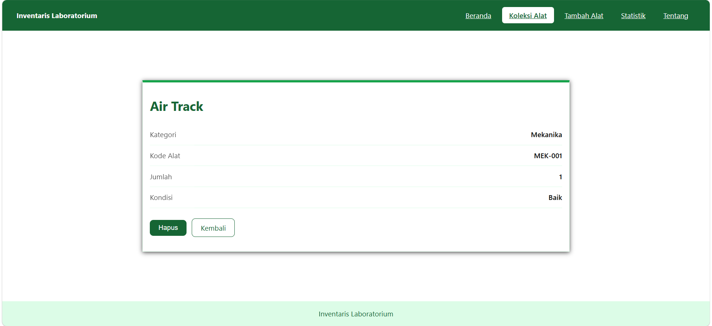
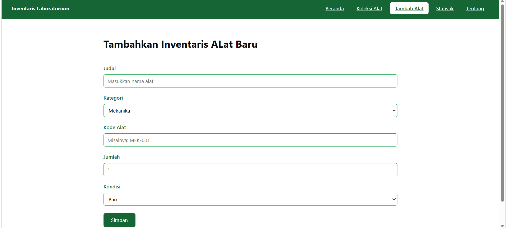
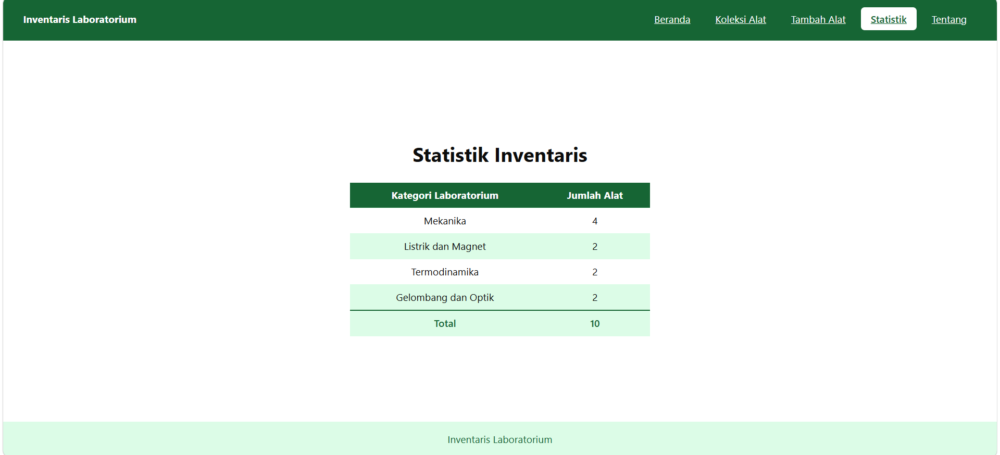
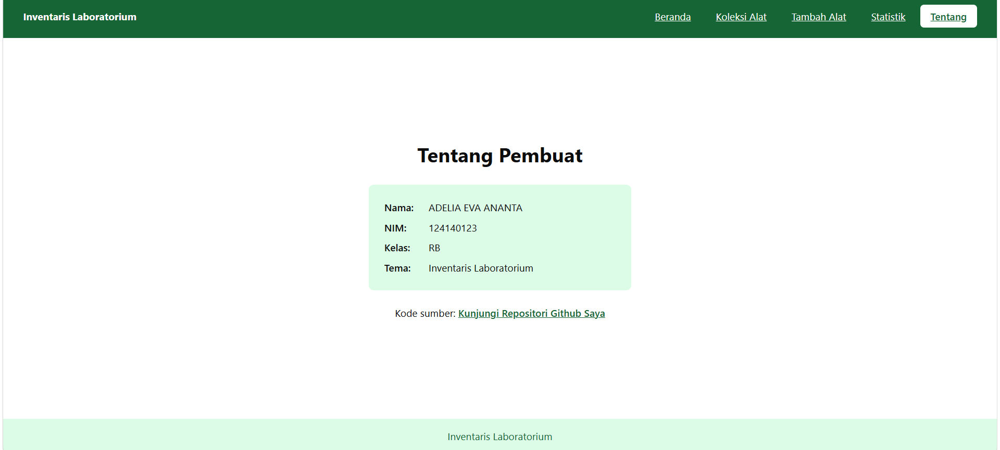
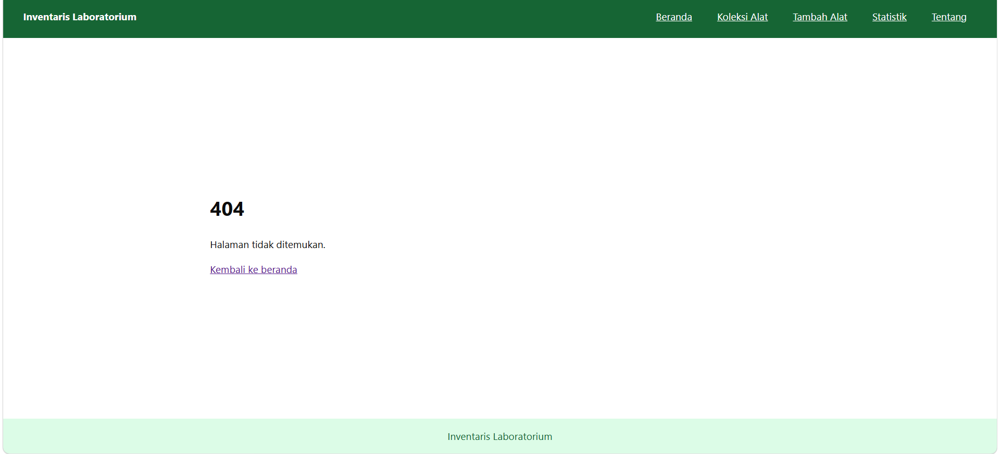

# Inventaris Laboratorium 

Aplikasi web yang digunakan untuk mengelola inventaris alat-alat laboratorium fisika, yang dibuat untuk memenuhi syarat mengikuti Ujian Tengah Semester Pengembangan Aplikasi Web.

## Identitas
- **Nama:** ADELIA EVA ANANTA
- **NIM:** 124140123
- **Kelas:** RB
- **Tema:** Inventaris Laboratorium

## URL Deployment
https://adelia124140123.github.io/uts-paw/

## Daftar Fitur
- Beranda yang berisi ringkasan jumlah alat dan kategorinya
- Daftar koleksi alat yang berbentuk tabel
- Pencarian alat yang berdasarkan nama alat dan filter kategori
- Halaman detail alat yang berisi kategori, kode alat, jumlah, dan kondisi
- Menghapus alat dengan adanya konfirmasi dari server
- Menambahkan alat baru dengan memvalidasi judul, jika kosong maka akan ditampilkan pesan error
- Statistik jumlah alat yang berisi alat per kategori
- Halaman tentang yang berisi biodata pembuat web
- Halaman 404 yang ditampilkan untuk alamat yang tidak dikenal
- Data awal dari `koleksi.json`, kemudian perubahan data disimpan di LocalStorage

## Tangkapan Layar









## Cara Menjalankan
Menjalankan secara lokal:

```bash
cd app
npm install
npm run dev
```
Setelah itu buka `http://localhost:5173/` di browser. akan tertampil halaman web yang sudah dibuat. dan untuk menjalankan pengujian caranya adalah:

```bash
npm test
```

## Konsep React yang dipakai

- **useState dan useEffect:** `useState` menyimpan data yang bisa berubah. contohnya pencarian, kategori, dan status loading. sedangkan `useEffect` dipakai untuk mengambil data dari `koleksi.json` saat aplikasi pertama kali dibuka.
- **Context API:** daftar alat disimpan di satu tempat yaitu `koleksiProvider` lalu diteruskan ke halaman Koleksi, Detail, Tambah, Statistik, dan Beranda. jadi kita tidak perlu mengirim data dari satu komponen ke komponen lain secara manual.
- **Custom Hook:** `useLocalStorage` menyimpan data ke browser supaya datanya tidak hilang saat halaman di re-fresh, dan `useKoleksi` memudahkan halaman mengambil data dari Context.
- **React Router:** dipakai untuk 7 rute, yaitu (`/`, `/koleksi`, `/koleksi/:id`, `/tambah`, `/statistik`, `/tentang`, `*` untuk 404). `useParams` mengambil id alat dari alamat, `useNavigate` memindahkan halaman setelah menyimpan atau menghapus, dan `NavLink` membuat menu di header.
- **Fetch dan async/await:** data awalnya diambil dari `koleksi.json`. selama menunggu, tampilkan teks "Memuat data...", lalu jika gagal akan menampilkan pesan error.
- **Komponen:** tampilan dipecah menjadi bagian bagian kecil yang isinya bisa dipakai ulang, contohnya `Layout`, `kotakPencarian`, `filterKategori`, `tabelKoleksi`, dan `kartuItem`.